# E1-2 나만의 퀴즈 게임 (Python 콘솔)

## 1. 프로젝트 개요

터미널에서 동작하는 **객관식 퀴즈 게임**을 Python으로 처음부터 끝까지 구현하는 미션입니다.

- 메뉴에서 퀴즈 풀기 / 추가 / 목록 / 점수 확인 / 종료를 선택한다.
- 클래스(`Quiz`, `QuizGame`)로 역할을 나눠 코드를 구조화한다.
- 퀴즈와 최고 점수를 `state.json`에 저장해, 프로그램을 다시 실행해도 데이터가 유지된다.
- Git으로 기능 단위 커밋, 브랜치 생성·병합, clone·pull을 경험한다.

| 항목 | 내용 |
|---|---|
| 언어 | Python 3.14.7 (3.10 이상 필요) |
| 외부 라이브러리 | 없음 (표준 라이브러리 `json`, `os`, `random`, `datetime`, `sys`만 사용) |
| 데이터 파일 | 프로젝트 루트의 `state.json` (UTF-8) |

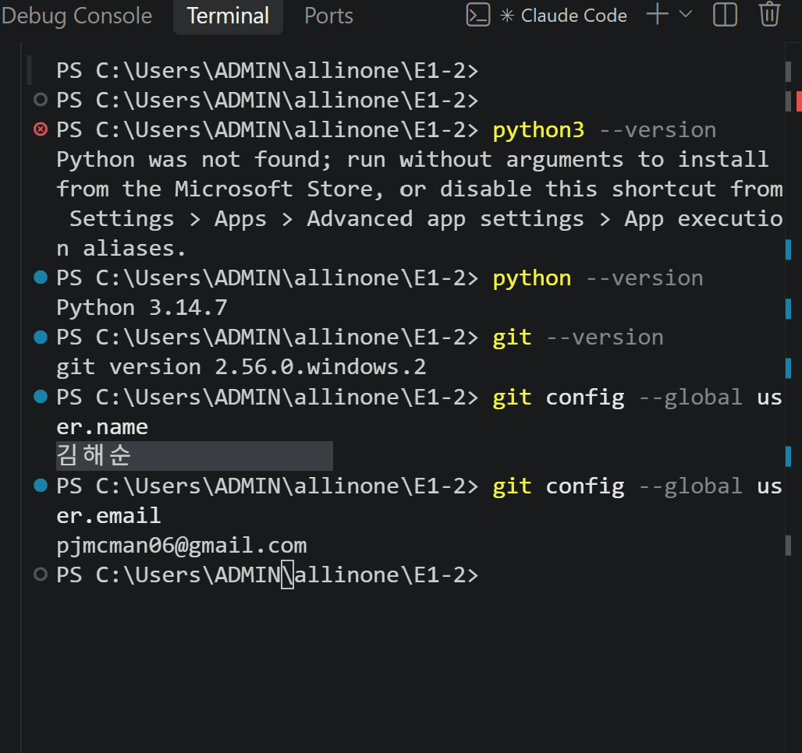

## 2. 퀴즈 주제와 선정 이유

**주제: 이번 미션에서 배운 Python·Git 기초 개념**

이 미션이 끝나면 배운 내용으로 시험을 본다. 그래서 퀴즈 게임 자체를 **시험 대비 복습 도구**로 만들었다.
변수와 자료형, 조건문·반복문, 함수, 클래스와 `self`, 파일 입출력과 JSON, 예외 처리, Git 명령어를 문제로 출제한다.
게임을 만들면서 직접 쓴 개념을, 게임을 풀면서 다시 확인할 수 있다.

| 분야 | 기본 문제 |
|---|---|
| 자료형·반복문 | `type([1, 2, 3])`의 결과, for와 while의 선택 |
| 클래스 | `__init__`이 호출되는 시점, `self`가 가리키는 것 |
| 파일·JSON | `json.dump()`, `with open`을 쓰는 이유 |
| 예외 처리 | `int('abc')` → `ValueError`, Ctrl+C → `KeyboardInterrupt` |
| Git | `git checkout -b`, `git clone`과 `git pull`의 차이 |

## 3. 실행 방법

```bash
git clone https://github.com/pjmcman/git-quiz-mission.git
cd git-quiz-mission
python main.py
```

- Python 3.10 이상이 필요하다. 설치할 패키지는 없다.
- 처음 실행하면 `state.json`이 없으므로 기본 퀴즈 10개로 시작하고 파일을 새로 만든다.
- 어느 폴더에서 실행해도 `main.py`가 있는 폴더(프로젝트 루트)의 `state.json`을 사용한다.

## 4. 기능 목록

| 메뉴 | 기능 | 설명 |
|---|---|---|
| 1 | 퀴즈 풀기 | 등록된 퀴즈를 **무작위 순서**로 출제하고, 정답/오답을 바로 알려 준다. 다 풀면 `N문제 중 M문제 정답 (점수)`를 보여 주고 최고 점수와 비교해 갱신한다. |
| 2 | 퀴즈 추가 | 문제, 선택지 4개, 정답 번호(1-4)를 입력받아 등록하고 즉시 `state.json`에 저장한다. |
| 3 | 퀴즈 목록 | 등록된 퀴즈를 `[번호] 문제` 형식으로 보여 준다. |
| 4 | 점수 확인 | 최고 점수와 그때의 정답 수, 최근 5회 플레이 기록(날짜/시간, 문제 수, 점수)을 보여 준다. |
| 5 | 종료 | 데이터를 저장하고 종료한다. |

**보너스 구현:** 랜덤 출제(`random.shuffle`), 점수 기록 히스토리(날짜/시간·문제 수·점수)

### 입력 · 예외 처리

| 상황 | 처리 |
|---|---|
| 앞뒤 공백 (` 1 `) | 공백을 제거하고 `1`로 처리 |
| 빈 입력 (그냥 Enter) | `⚠️ 빈 값은 입력할 수 없습니다.` 후 다시 입력 |
| 숫자가 아닌 입력 (`abc`) | `⚠️ 잘못된 입력입니다. 1-5 사이의 숫자를 입력하세요.` 후 다시 입력 |
| 범위 밖 숫자 (메뉴 `9`, 정답 `0`) | 같은 안내 후 다시 입력 |
| 퀴즈가 하나도 없음 | 풀기·목록에서 `등록된 퀴즈가 없습니다` 안내 |
| 아직 퀴즈를 풀지 않음 | 점수 확인에서 `아직 퀴즈를 풀지 않았습니다` 안내 |
| `Ctrl+C` / 입력 종료(EOF) | `입력이 중단되었습니다` 안내 후 **저장하고** 안전하게 종료 |
| `state.json` 없음 | 기본 퀴즈 10개로 시작하고 파일 생성 |
| `state.json` 손상 (JSON 문법 오류, 키 누락, 잘못된 값) | `데이터 파일이 손상되어 기본 퀴즈로 복구합니다` 후 기본 데이터로 복구 |
| `state.json` 쓰기 실패 | `데이터를 저장하지 못했습니다` 안내 (프로그램은 계속 실행) |

## 5. 실행 화면

| 메뉴 | 잘못된 입력 처리 |
|---|---|
| 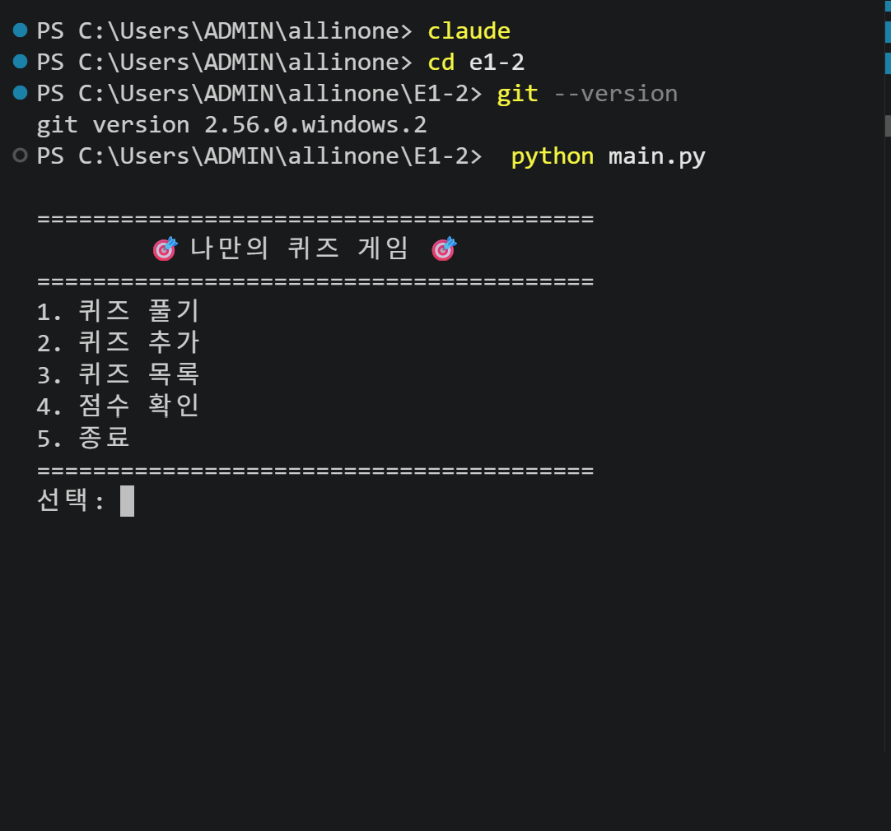 | 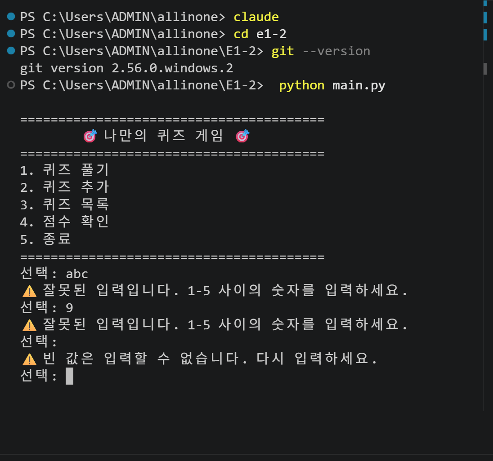 |

| 퀴즈 풀기 (정답/오답) | 퀴즈 풀기 (결과·최고 점수 갱신) |
|---|---|
| 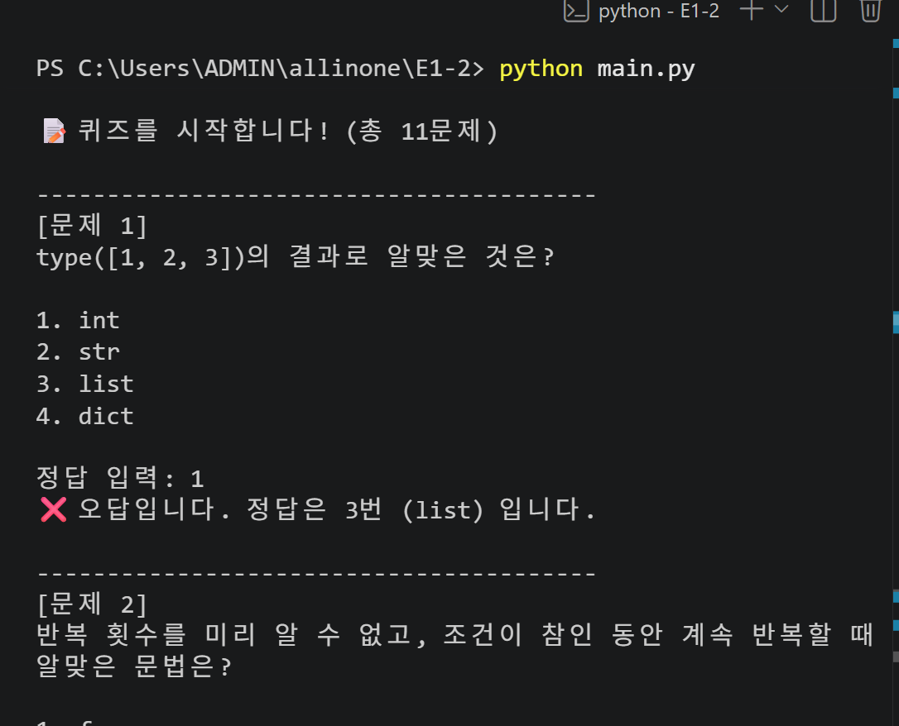 | 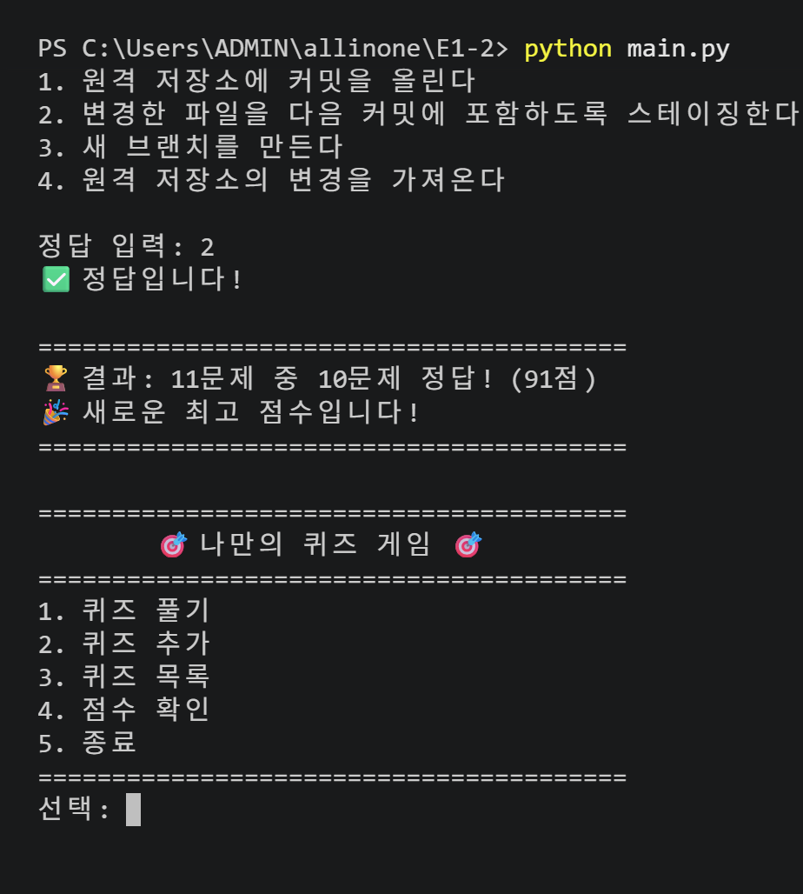 |

| 퀴즈 추가 | 퀴즈 목록 |
|---|---|
| 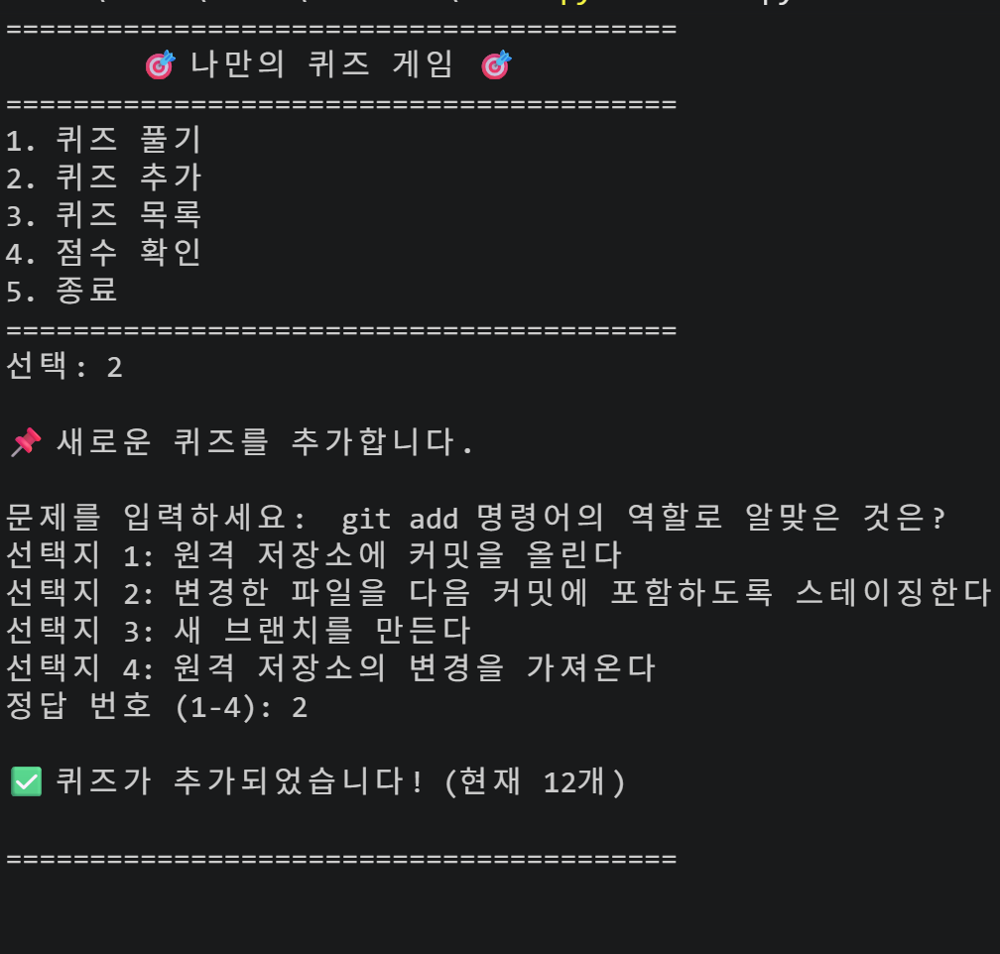 | 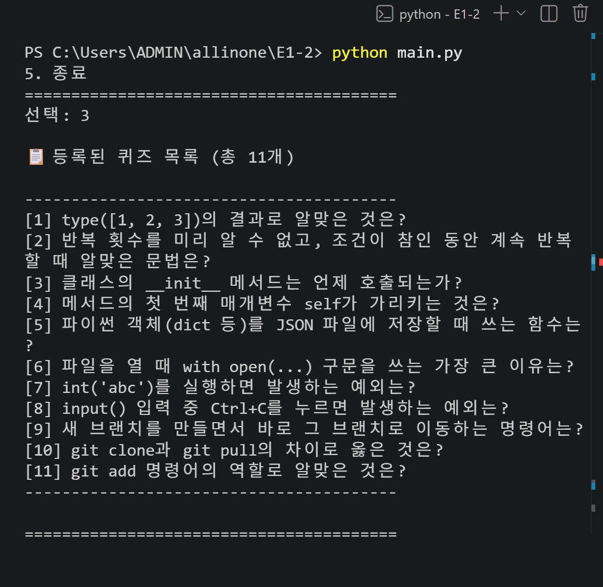 |

| 점수 확인 | 플레이 기록 (보너스) |
|---|---|
| 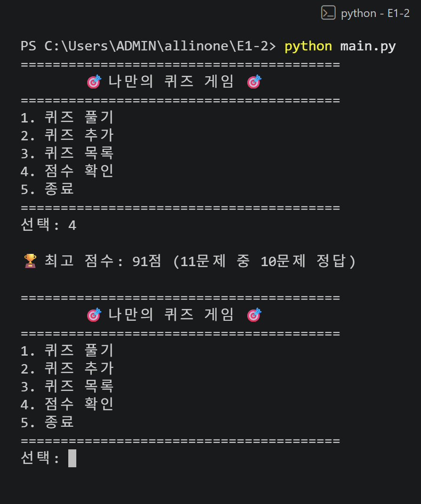 | 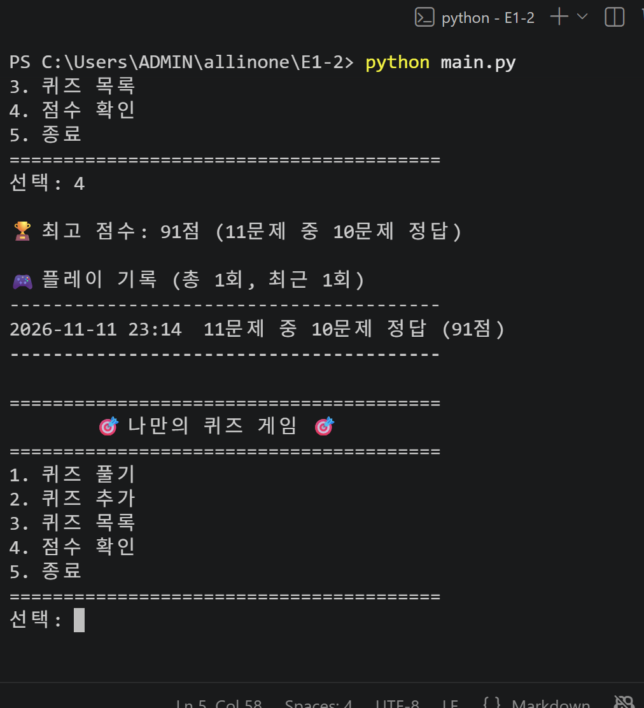 |

**재실행 후 데이터 유지** (추가한 퀴즈 11개, 최고 점수 91점이 그대로 남아 있음)

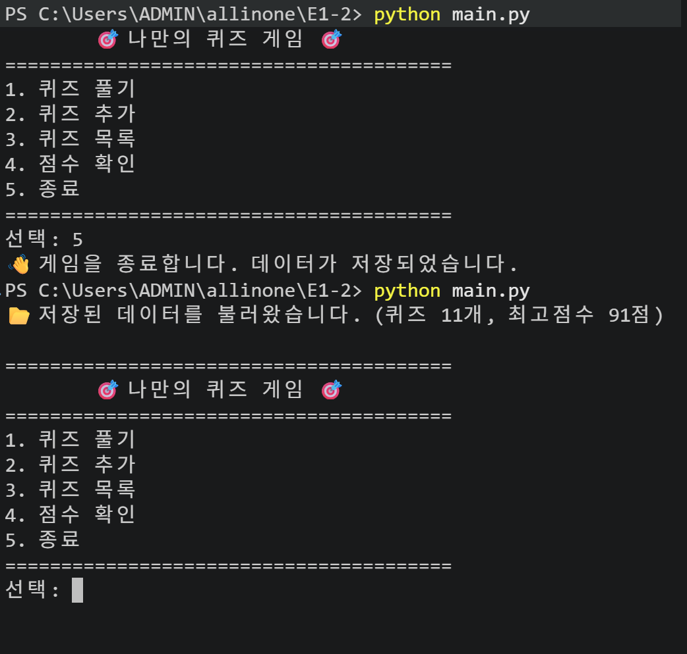

## 6. 파일 구조

```
E1-2/
├── main.py            # 실행 진입점: python main.py (state.json 경로 결정, UTF-8 출력 설정)
├── quiz.py            # Quiz 클래스: 문제 1개 (출력, 정답 확인, dict 변환)
├── quiz_data.py       # 기본 퀴즈 10개 (create_default_quizzes)
├── quiz_game.py       # QuizGame 클래스: 메뉴, 게임 진행, 입력 처리, 저장/불러오기
├── state.json         # 실행하면 자동 생성되는 데이터 파일 (.gitignore로 Git에서 제외)
├── .gitignore         # __pycache__/, *.pyc, .vscode/, state.json 제외
├── README.md
└── docs/
    └── screenshots/   # 실행 화면·개발 환경·Git 기록 스크린샷
```

### 클래스 설계

| 클래스 | 역할 | 속성 | 주요 메서드 |
|---|---|---|---|
| `Quiz` | 퀴즈 1개 | `question`, `choices`(4개), `answer`(1-4) | `display()`, `is_correct()`, `to_dict()`, `from_dict()` |
| `QuizGame` | 게임 전체 관리 | `quizzes`, `best_score`, `best_detail`, `history`, `state_file` | 아래 표 |

`QuizGame`의 메서드는 역할별로 나뉘어 있다.

| 역할 | 메서드 |
|---|---|
| 저장 / 불러오기 | `load_state()`, `apply_state()`, `save_state()`, `reset_to_default()` |
| 입력 처리 | `read_text()`, `read_number()`, `read_answer()` |
| 퀴즈 풀기 | `play()`, `ask_question()`, `show_result()`, `update_best_score()`, `record_history()` |
| 추가 / 목록 / 점수 | `add_quiz()`, `list_quizzes()`, `show_score()`, `show_history()` |
| 메인 루프 | `show_menu()`, `run()` (메뉴 번호와 기능은 `MENU` 표 하나로 관리) |

## 7. 데이터 파일 설명 (`state.json`)

- **경로:** 프로젝트 루트 (`main.py`와 같은 폴더)의 `state.json`
- **인코딩:** UTF-8 (`ensure_ascii=False`라서 한글이 그대로 보인다)
- **역할:** 퀴즈 목록, 최고 점수, 플레이 기록을 저장해 프로그램을 다시 실행해도 유지한다.
- **저장 시점:** 퀴즈 추가 직후, 퀴즈 풀기가 끝난 직후, 5번 종료할 때, Ctrl+C/EOF로 종료할 때
- **Git:** 실행할 때마다 내용이 바뀌는 파일이라 `.gitignore`로 저장소에서 제외했다. 없으면 첫 실행 때 자동으로 만들어진다.

### 스키마

```json
{
  "quizzes": [
    {
      "question": "type([1, 2, 3])의 결과로 알맞은 것은?",
      "choices": ["int", "str", "list", "dict"],
      "answer": 3
    }
  ],
  "best_score": 91,
  "best_detail": { "correct": 10, "total": 11 },
  "history": [
    { "played_at": "2026-11-11 23:14", "total": 11, "correct": 10, "score": 91 }
  ]
}
```

| 키 | 타입 | 설명 |
|---|---|---|
| `quizzes` | list | 퀴즈 목록. 각 항목은 `question`(str), `choices`(str 4개 list), `answer`(1-4 int) |
| `best_score` | int 또는 `null` | 최고 점수(100점 만점). 아직 풀지 않았으면 `null` |
| `best_detail` | dict 또는 `null` | 최고 점수를 낸 판의 맞힌 수(`correct`)와 문제 수(`total`) |
| `history` | list | 플레이 기록. `played_at`(날짜/시간), `total`, `correct`, `score` |

점수는 `round(맞힌 수 / 문제 수 × 100)`으로 계산한다.

## 8. Git 작업 기록

| 명령어 | 사용한 곳 |
|---|---|
| `git init` | 로컬 저장소 생성 |
| `git add` / `git commit` | 기능 단위 커밋 (`Feat:`, `Docs:`, `Refactor:`, `Chore:`) |
| `git push` | GitHub 저장소에 업로드 |
| `git checkout` | `feature/play` 브랜치 생성·이동, main 복귀 |
| `git merge` | `git merge --no-ff feature/play`로 퀴즈 풀기 기능 병합 |
| `git clone` / `git pull` | 다른 폴더에 복제 → 수정·push → 원래 폴더에서 pull |

> clone/pull 실습 (Claude 시연): 이 줄은 복제한 폴더(E1-2-clone)에서 추가한 뒤 push했다.

**브랜치 병합 과정** (`git checkout main` → `git merge --no-ff feature/play`)

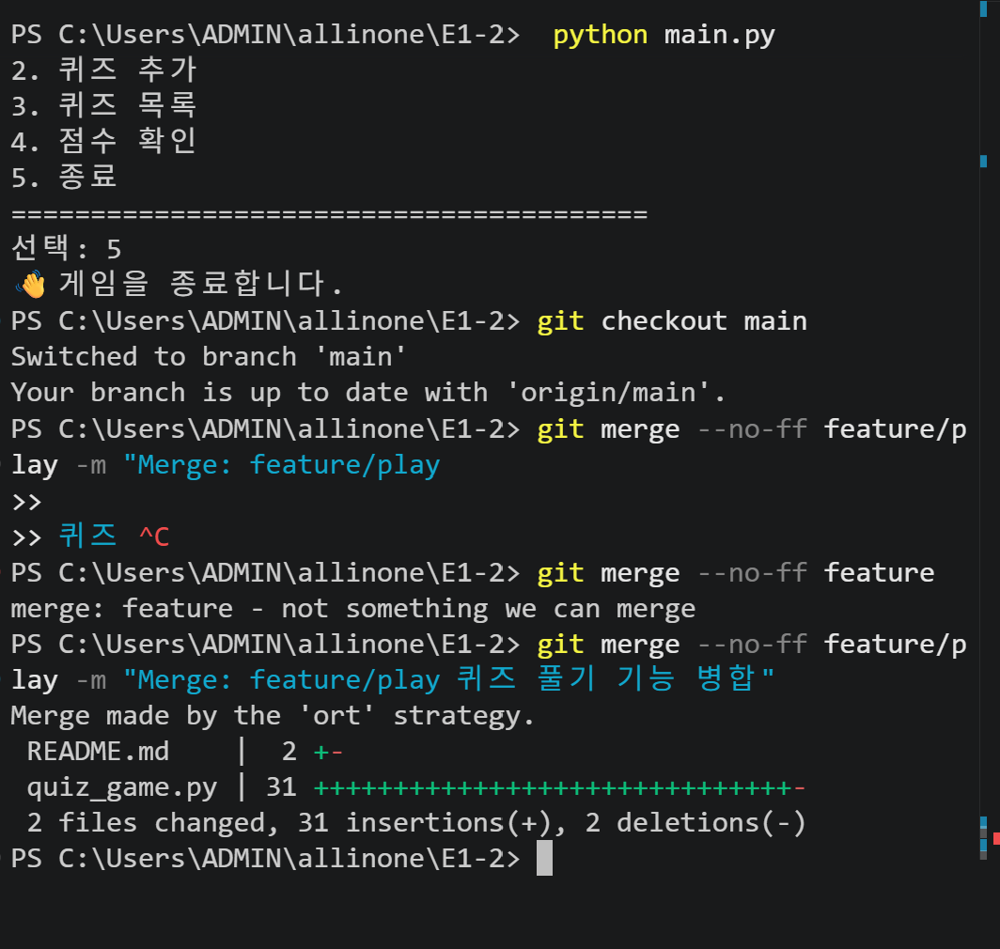

<!-- clone/pull 실습 후 git log --oneline --graph 스크린샷 추가 예정: docs/screenshots/git_log.png -->

## 진행 체크리스트

> 한 단계가 끝날 때마다 `[ ]`를 `[x]`로 바꾼다. 🙋 표시는 **내가 직접** 해야 하는 일이다.

### 0. 준비 🙋
- [x] GitHub에 새 저장소 만들기 (Public, README/.gitignore 체크 안 함)
- [x] 로컬 저장소와 연결: `git remote add origin <저장소 URL>`
- [x] 첫 push: `git push -u origin main`
- [x] 개발 환경 스크린샷 찍기 (VSCode, `python --version`, `git config --list`) → `docs/screenshots/env.png`

### 1. 기능 개발 (단계마다 커밋)
- [x] 1. Chore: 초기 설정 (.gitignore, README 개요)
- [x] 2. Feat: 메뉴 출력과 입력 예외 처리 (잘못된 입력, 빈 입력, Ctrl+C/EOF)
- [x] 3. Feat: Quiz 클래스 (문제·선택지 4개·정답, 출력, 정답 확인)
- [x] 4. Feat: 기본 퀴즈 데이터 10개
- [x] 5. Feat: 퀴즈 풀기 🙋 **브랜치 작업**
  - `git checkout -b feature/play` → 개발·커밋
  - `git checkout main` → `git merge feature/play` → `git push`
- [x] 6. Feat: state.json 저장/불러오기 (파일 없음·손상 처리)
- [x] 7. Feat: 퀴즈 추가
- [x] 8. Feat: 퀴즈 목록
- [x] 9. Feat: 최고 점수 확인
- [x] 10. Feat: 랜덤 출제 + 점수 기록 히스토리 (보너스)
- [x] 11. Refactor: QuizGame 구조 정리
- [x] 12. Docs: README 완성 (실행 방법, 기능 목록, 파일 구조, state.json 설명) → 최종 push

### 2. clone / pull 실습 🙋
- [ ] 다른 폴더에서 `git clone <저장소 URL>`
- [ ] 복제한 폴더에서 README에 한 줄 추가 → commit → push
- [ ] 원래 폴더로 돌아와 `git pull` → 변경 반영 확인

### 3. 제출물 🙋
- [x] 실행 화면 스크린샷 → `docs/screenshots/` (menu.png, play.png, add_quiz.png, score.png)
- [ ] `git log --oneline --graph` 스크린샷 → `docs/screenshots/git_log.png`
- [ ] GitHub 저장소 URL 제출
